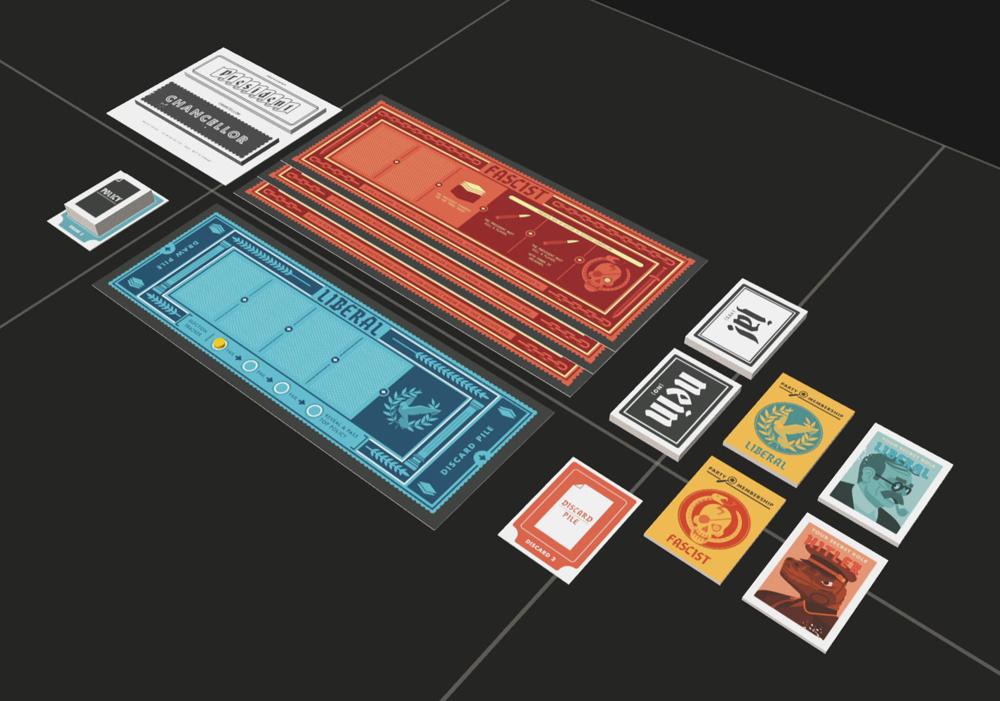

# Secret Hitler

## Saved game

[Download the Probability game](dist/secret-hitler.zip). The saved layout includes a functional 40 × 40 cm private play area, replacing the placeholder mat at the same position and rotation, with its 4 mm thickness and locked state preserved. The original mat SVG remains in `src/svg/mats` as source artwork but is no longer packaged in the game.

## Licence

Secret Hitler artwork: Goat, Wolf & Cabbage. Colour vector edition: Lee Yingtong Li, adapted from FragaholiC’s assets. CC BY-NC-SA 4.0.

9mm Luger bullet model: Ziperi. CC BY 4.0. See [LICENSE.md](LICENSE.md) for attribution and licence details.
